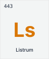

#  Listrum — The Sterile Field

> **Proprietary & Confidential** — © 2026 Listrum. All rights reserved.

This repository contains the marketing landing page for **Listrum**.

**Listrum** is the chemical barrier for the modern network. We deploy at the edge to ensure the environment remains sterile.

---

## The Philosophy: Digital Sepsis

We are moving away from military metaphors ("Attacks," "War," "Soldiers"). Ransomware is not an "army"; it is **sepsis**. It enters through a small wound (Edge breach), spreads through the bloodstream (Network), and shuts down organs (Servers).

**You cannot fight sepsis with bullets. You fight it with Sterility.**

### The Brand Identity

*   **The Name:** **Listrum** (Lister + -um). Named after Joseph Lister, the father of antiseptic surgery. It implies a new, heavy, foundational element.
*   **The Symbol:** **`Ls`** (Element) / **`ls`** (Listing command).
*   **The Number:** **`443`** (Secure Traffic).
*   **The Colors:** **Deep Slate** (Substrate) & **Safety Orange** (Active Protection).
*   **The Motto:** "We do not guess. We verify."

---

## The Experience

Listrum is deterministic. The software output reads like a lab report.

```bash
user@cisco-edge:~$ listrum verify

[Ls] LISTRUM PROTOCOL v2.0
--------------------------
> ISOLATION ZONE.... [SECURE]
> ATOMIC CHECKS..... [PASS]
> STERILITY......... [100%]

[INFO] No foreign agents detected in the sterile field.
```

---

## Tech Stack

-   **Framework:** Next.js 16 (App Router)
-   **UI:** Tailwind CSS 4, Radix UI, Lucide Icons
-   **Language:** TypeScript
-   **Package Manager:** pnpm

---

## Getting Started

### Prerequisites

-   Node.js 18+
-   pnpm (`npm install -g pnpm`)

### Installation

```bash
# Clone the repository
git clone <repository-url>
cd cortexcli-landing-page

# Install dependencies
pnpm install --ignore-scripts
```

### Development

```bash
pnpm dev
```

Open [http://localhost:3000](http://localhost:3000) in your browser.

### Production Build

```bash
pnpm build
pnpm start
```

---

## Project Structure

```
├── app/              # Next.js App Router pages
├── components/       # Reusable UI components
├── hooks/            # Custom React hooks
├── lib/              # Utility functions
├── public/           # Static assets
├── styles/           # Global stylesheets
└── package.json
```

---

## License

This software is proprietary and confidential. Unauthorized copying, distribution, or use is strictly prohibited.
